# Arc 原生图的 PR 动态讲解展示

主要场景来自五个外部大仓库的真实历史 PR，覆盖调度器重写、编译产物变化、协议接入与同步兼容、GPU 分区计算、API 类型引入。保留 Arc #1359 作为自身基线，作者结账 demo 作为同一输入的 PRLens 对照。

## 场景与材料

| 案例 | 原生结构 | 讲解主线 |
| --- | --- | --- |
| Tokio #1657 | 架构 → 生命周期 | 队列替换、任务迁移、搜索与停泊 |
| Vue #2532 | 数据流 → 函数局部 | 绑定信息、内联模板、prefix 指标 |
| Django #11209 | 时序 → 流程 | ASGI 与同步视图交接、安全保护 |
| vLLM #1348 | 流程 → 数据流 → 源码 | V1/V2 分流、分区与归并 |
| Kubernetes #14175 | 架构 → 类型 | 注册与生成代码、API 包含结构 |
| Arc #1359 | 架构 → 流程 → 函数局部 | PR 分析接入与局部复杂度 |

每例的共同基点与 head、选择范围和分镜保存在 manifest.json、source-index.json 与 story-plans/。动态图在 images/，静态回退帧在 stills/，原生 typed JSON 在 models/，冻结原生导出在 native/。原先搬迁和循环最小案例保留为辅助材料。

## 当前基础与探索边界

可内嵌导出已有本地实现，CLI 单视图路径与多结构探索管线分别记录。分析产物已经按案例接入，通用自动绑定尚未完成。分镜和部分对象对应由 Agent 显式编排。

指标定位到实际改变的函数：Vue 的外层 processExpression 仍为 22 → 22，而其嵌套 prefix 为 2 → 6。原生分析器分别统计嵌套函数，当前动态图将数值附着于 prefix；具体位置和嵌套指标在 measurements/vue.json。

## 复现动态图

需要 Node 22 和现有 Arc 源码目录，使用冻结原生 SVG 重放下游讲解。PowerShell 中设置 ARCHIFY_SOURCE 为已有 Arc 仓库根目录，然后从本目录执行 node ./compile-plan.mjs。命令不安装 Skill，不连接模型，不扫描外部仓库。

渲染开发版本见 manifest.json。models/ 和 native/ 保留这次原生输入与导出；上述命令不重新生成冻结输入。完整外部 PR 分析在 EXTERNAL-ANALYSIS.zh-CN.md。

## 编排与检查记录

客户端 Codex，模型 GPT-6.1 Sol（gpt-6.1-sol）。依据公开 PR 和核心源码差异编排，程序测量与 Agent 解释分开。动态图已在隔离 Chrome 中生成明暗主题关键帧并检查；最终 GitHub 附图播放和正式交付验收尚未进行。

## 署名

原生图形与分析来自 tt-a1i/archify。PR 图标使用 Primer Octicons git-pull-request-16（MIT），脚本保留注释。PRLens 图片使用其公开仓库固定版本或作者已发布的附件链接，不修改原图，不引入外部画布入口。
