# AI 时代 PR 讲解：意图、架构与复杂度

本目录使用 **`archify/story` 通用图组件编排引擎**，探索如何围绕三个问题讲解 PR：**目的是什么（意图与契约）**、**架构如何变化**、**复杂度发生在哪一层**。图解帮助定位源码和理解结构；结论仍需通过代码、测试与人工判断复核。

设计思路、实践边界和延伸阅读见 [AI-ERA-PR-REVIEW.zh-CN.md](AI-ERA-PR-REVIEW.zh-CN.md)。这是案例探索。

## 展示案例一览（三问框架 × 四类跨视图编排）

| 审查维度（PR 三问） | 展示案例 | 原生图谱组合 | 揭示的关键信号 | 产物入口 |
| --- | --- | --- | --- | --- |
| **1. 目的是什么**<br>意图与契约偏移 | **Pulse Billing PR #5** | `architecture → sequence → erd` | 首次请求返回 `202`、`invoiceId` 和 `jobId`，重复请求返回 `202` 和已有 `invoiceId`。账单改按组织归属，入队接口仍为示例桩 | [Stage](stages/pulse-billing.stage.html) · [1080p MP4](videos/pulse-billing.mp4) |
| **2. 架构影响了什么**<br>所有权与并发状态 | **Tokio #1657** | `architecture → lifecycle` | 100 文件调度器重写收敛为有界环形队列 + 溢出窃取 + Worker 状态迁移 | [Stage](stages/tokio-scheduler.stage.html) · [1080p MP4](videos/tokio-scheduler.mp4) |
| **2. 架构影响了什么**<br>通用引擎解耦（自举） | **Archify Line A 拆分** | `architecture → dataflow` | 通用 AST 编排引擎与领域 Skill 解耦，`StoryContainer` 支持 fast-start MP4 与 4 帧批量回读 | [Stage](stages/arc-story-split.stage.html) · [1080p MP4](videos/arc-story-split.mp4) |
| **3. 复杂度发生在哪一层**<br>局部指标变化 | **Vue #2532** | `dataflow → architecture` | 固定版本度量：外层 `22 → 22`、嵌套 `prefix()` 为 `2 → 6`（源码行级定位） | [Stage](stages/vue-complexity.stage.html) · [1080p MP4](videos/vue-complexity.mp4) |

来源固定于 [source-revisions.json](source-revisions.json)。Vue 的[度量快照](measurements/vue.json)由调用方提供；Story 引擎负责展示，不自动执行代码分析。Pulse 的 [Schema](inputs/pulse/schema-head.sql)、[迁移](inputs/pulse/0002_org_billing.sql)和[队列示例桩](inputs/pulse/checkoutQueue.ts)均随案例保留。

Stage HTML 需要下载后在浏览器打开，GitHub 文件预览不会执行它；下方 SVG 可直接在 Markdown 中播放。PR 评论中的动态图是预编排播放，不提供点击交互。

## 在线预览（GitHub 自适应明暗动态 SVG）

### 1. 意图与契约偏移：Pulse Billing PR #5（同步直付 → 异步幂等队列）

<picture>
  <source media="(prefers-color-scheme: dark)" srcset="images/pulse-billing-dark.svg">
  
</picture>

### 2. 架构影响（外部大型工程）：Tokio #1657 调度器重写与 Worker 生命周期

<picture>
  <source media="(prefers-color-scheme: dark)" srcset="images/tokio-scheduler-dark.svg">
  
</picture>

### 3. 架构影响（本引擎自举 PR）：通用组件编排与 MP4/内存优化拆分

<picture>
  <source media="(prefers-color-scheme: dark)" srcset="images/arc-story-split-dark.svg">
  
</picture>

### 4. 复杂度代价：Vue #2532 嵌套函数 `prefix()` 复杂度 `2 → 6`

<picture>
  <source media="(prefers-color-scheme: dark)" srcset="images/vue-complexity-dark.svg">
  
</picture>

## 本地一键复现

需要 Node 22+ 与对应分支的 `archify` 源码仓库（生成 MP4 视频还需本机 Chrome / Edge WebCodecs 支持）：

```powershell
$env:ARCHIFY_BIN = "C:/path/to/archify/bin/archify.mjs"
$env:ARCHIFY_CHROME = "C:/Program Files/Google/Chrome/Application/chrome.exe"
node docs/pr-walkthrough/build-showcase.mjs --with-video
```

说明：若仅需生成双主题动态 SVG、静态关键帧 `stills/` 与交互舞台 HTML `stages/`，可省略 `--with-video`。使用配套引擎 [tt-a1i/archify#1398](https://github.com/tt-a1i/archify/pull/1398) 的固定提交，具体版本由构建清单记录；本脚本的视频样例选择 1080p 30fps。

## 署名与许可

- 原生图表渲染与通用编排引擎：`tt-a1i/archify`（Apache-2.0，摘录源码片段与 [arc-LICENSE](attribution/arc-LICENSE) 一并保留）。
- Vue `#2532` 编译器源码片段保留 [vue-LICENSE](attribution/vue-LICENSE)（MIT）。
- 案例编排与文本梳理基于公开 PR 差异、`inputs/` 实测源码及 `feat/story-choreography-engine` 实测产物。
